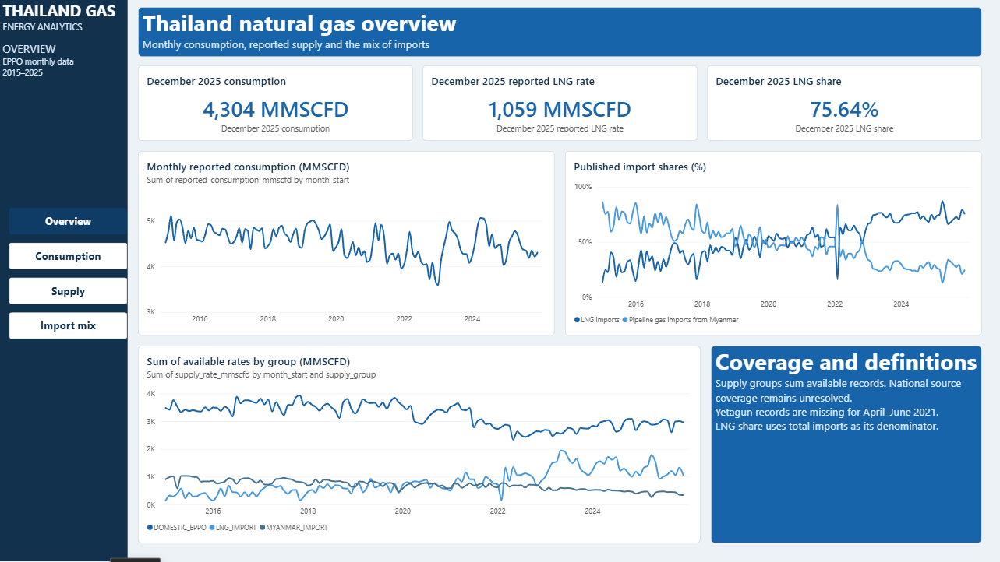

# Thailand Natural Gas Supply & Demand: A Data Warehouse and BI Dashboard

An independent data analytics portfolio project using official public Thai energy statistics.

This project turns monthly EPPO statistics into a DuckDB warehouse and a four-page Power BI report covering January 2015 through December 2025. It preserves original CSV snapshots, validates and converts observations to typed Parquet, loads fact and dimension tables, and exports Gold reporting views. The warehouse retains 2014 as comparison history.

| Report page | What it shows |
| --- | --- |
| Overview | December 2025 highlights and monthly trends |
| Consumption | Sector rates, reported totals and shares |
| Supply | Available reported rates by source and supply group, with coverage notes |
| Import Mix | EPPO's published LNG and Myanmar pipeline shares of total imports |

In December 2025, reported sector consumption was **4,304 MMSCFD**, the reported LNG supply rate was **1,059 MMSCFD**, and LNG accounted for **75.64% of imports**. National supply completeness remains unresolved, so import dependence is pending. The dashboard covers the available EPPO observations for the selected period. Partial-year 2026 reporting and DMF integration are deferred.


[Consumption page preview](docs/images/power-bi-consumption.png) · [Import Mix page preview](docs/images/power-bi-import-mix.png)

- [Business requirements, KPI definitions, and acceptance criteria](docs/business_requirements.md)
- [Verified sources, observed coverage, and feasibility recommendation](docs/source_assessment.md)
- [Cleaning rules, quality decisions, and validation tolerances](docs/data_quality_rules.md)
- [Warehouse design explained in small steps](docs/warehouse_design.md)
- [Progress, verification evidence, unresolved questions, and next step](docs/PROGRESS.md)

- [Warehouse load, Gold views, and Power BI release checks](docs/warehouse_checkpoint.md)

The report is available as a local Power BI Desktop file. The repository contains the code and documentation used to reproduce the underlying exports.

## Setup

Use Python 3.11 or newer (initial setup verified with Python 3.14).

```bash
python3 -m venv .venv
source .venv/bin/activate
python -m pip install --upgrade pip
python -m pip install -r requirements.txt
```

On Debian/Ubuntu, install the matching `python3-venv` package if virtual environment creation reports missing `ensurepip`.

## Work in notebooks

```bash
source .venv/bin/activate
python -m jupyterlab
```

In VS Code, select `.venv/bin/python` as the Python interpreter and notebook kernel. The environment includes ipykernel; no global kernel registration is required.

Use pandas and NumPy for preparation, DuckDB for SQL directly over dataframes, CSV, and Parquet, SQLAlchemy for database connections, openpyxl for Excel, and Matplotlib/Seaborn for charts. External databases may require an additional vendor driver.

## Data and outputs

Keep local inputs under `data/raw/`, prepared data under `data/processed/`, and exports under `outputs/`. These directories, local databases, notebook checkpoints, credentials, and virtual environments are ignored by Git. Source-assessment downloads are local only, under `data/raw/source_assessment/`. Do not commit raw downloads or notebook outputs containing source data. Never add LNG tonnes to gas volume; see the unit rules in the business requirements.

## Verify the installation

```bash
source .venv/bin/activate
python -m pip check
python -m jupyterlab --version
```

These commands check dependency compatibility and confirm that JupyterLab is installed. They do not validate source data or run a pipeline.

### Inspect the retained EPPO supply file

From the repository root:

```bash
.venv/bin/python src/gas_pipeline/inspect_source.py
.venv/bin/python -m unittest discover -s tests -v
```

The checker reads the retained snapshot without changing it and writes the latest
inspection report to `outputs/validation/eppo_supply_inspection.json` (ignored by
Git). It works from other working directories too, using paths relative to the
project. Missing or changed input fails explicitly; it does not download data.
An inspection PASS is not approval to publish KPIs: component completeness and
cross-source reconciliation remain pending. See [progress](docs/PROGRESS.md).

To inspect the retained sector-consumption CSV using the same checker:

```bash
.venv/bin/python src/gas_pipeline/inspect_source.py --dataset consumption
```

This writes `outputs/validation/eppo_consumption_inspection.json` separately from
the supply report. It also requires ELECTRICITY, GSP, INDUSTRY, and NGV in each
2015–2025 reporting month; earlier history is not forced to have four sectors.
Both datasets retain their original MMSCFD rates. GSP is processing use, so the
sector sum is described as reported sector consumption, not final-use demand.

To inspect the import-share reference CSV:

```bash
.venv/bin/python src/gas_pipeline/inspect_source.py --dataset import-share
```

The ignored report is `outputs/validation/eppo_import_share_inspection.json`.
This checks the Share column, % unit, 0–100 bounds, LNG/MYANMAR categories,
and both categories in every reporting month. Their monthly sum must be within
0.1 percentage point of 100%, under the documented project policy. It does not
yet compare these shares with calculations from the supply CSV, and does not
measure import dependence as a share of total national supply.

Compare LNG import mix calculated from supply with the published reference:

```bash
.venv/bin/python src/gas_pipeline/compare_import_share.py
```

The latest ignored report is `outputs/validation/import_share_comparison.json`.
Current retained-source result: 129 months PASS and April–June 2021 REVIEW because
YETAKUN observations are absent. Missing records are not zero-filled. Overall
REVIEW returns exit code 1; full baseline import-mix acceptance remains pending.

The [April YETAKUN source-resolution policy](docs/source_resolution_policy.md)
defines a narrow, traceable workbook supplement. It is documented but not yet
implemented; current comparison results remain 129 PASS / 3 REVIEW.

### Create the first Silver dataset

```bash
.venv/bin/python src/gas_pipeline/transform_supply.py
```

This validates the retained supply snapshot and saves a new run under
`data/processed/silver/supply/<run_id>/`. `supply.parquet` stores typed dates and
exact DECIMAL(18,6) rates together with original source text, row locators,
snapshot hashes, scope labels and review flags. `manifest.json` records input
inspection, current import-mix comparison, processing time, code identity and
output hash. Each run has its own folder; earlier runs are not overwritten.

All original records remain present. April–June 2021 import-mix issues remain
REVIEW; the proposed workbook supplement is not applied. National source
completeness remains UNRESOLVED. A successful transformation certifies the saved
representation, not approval to publish totals or KPIs. These generated files
are ignored by Git. Consumption/import-reference Silver outputs, DuckDB loading,
automatic downloading and scheduling remain future work.

To prepare the sector consumption Silver dataset, run:

```bash
.venv/bin/python src/gas_pipeline/transform_consumption.py
```

Each run writes `consumption.parquet` and `manifest.json` under the ignored
`data/processed/silver/consumption/<run_id>/` directory. Parquet preserves typed
months and exact MMSCFD rates alongside original CSV text and record numbers.
The four-sector completeness check covers the 2015–2025 reporting months.

To prepare the import-share reference Silver dataset, run:

```bash
.venv/bin/python src/gas_pipeline/transform_import_share.py
```

Each run saves `import_share.parquet` and `manifest.json` under the ignored
`data/processed/silver/import_share/<run_id>/` directory. Shares are stored as
exact percentages from 0 to 100 with original text and source record numbers.
