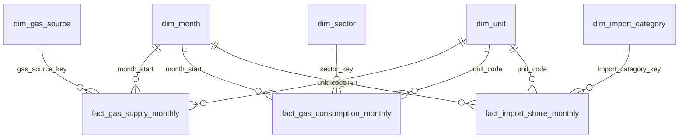
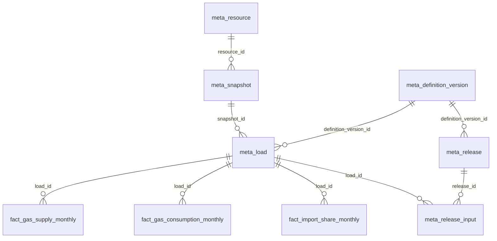
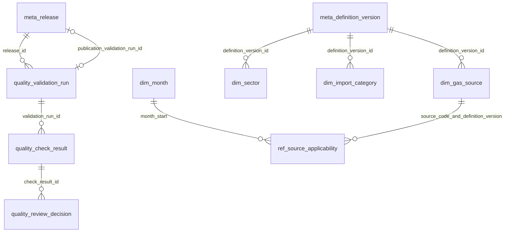
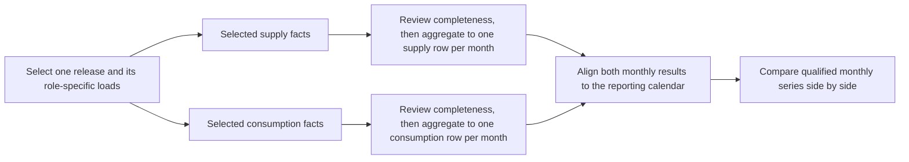

# Warehouse design, explained in small steps

Status: design draft reviewed 18 November 2026 (Asia/Bangkok); sufficient to begin the staged implementation described in 5.6. Database constraints and data acceptance are not yet tested. This document grew one sub-step at a time, starting 11 November 2026. No database, SQL schema, or pipeline has been created.

Follow the [business requirements](business_requirements.md), [source assessment](source_assessment.md), and [quality rules](data_quality_rules.md). Table names below are design proposals, not existing database objects.

## Learning sequence

| Sub-step | Design question | Status |
| --- | --- | --- |
| 5.1 | What does one measurement row represent? | Documented below |
| 5.2 | Which descriptive lookup tables (dimensions) do we need? | Documented below |
| 5.3 | Which columns, data types, and keys should the tables have? | Draft documented; provenance resolved in 5.4 and review refinements in 5.6 |
| 5.4 | How will source snapshots, revisions, and quality decisions be tracked? | Draft documented; pre-load validation refined in 5.6 |
| 5.5 | How do the tables relate, and how can queries avoid double-counting? | Draft diagrams and query rules documented below |
| 5.6 | Does the complete design support the scope, KPIs, and quality rules? | Documentation review complete; ready for step 6.1, not data/publication acceptance |

## 5.1 — Decide what one row represents

### Start with the observation, not SQL

Before creating tables, finish this sentence: **“One row represents…”** Database designers call this the table's **grain**. It tells us how much detail each record contains and what must distinguish one record from another.

The existing EPPO files already describe three different kinds of observations:

| Proposed measurement table | One row represents | Measured value | Original columns that explain it |
| --- | --- | --- | --- |
| `fact_gas_supply_monthly` | One month's reported gas-supply rate for one EPPO source, in its stated unit, within a selected snapshot and load interpretation | Supply rate, MMSCFD | `Year`, `Month`, `Source`, `Quantity`, `UNIT` |
| `fact_gas_consumption_monthly` | One month's reported gas-consumption rate for one EPPO sector, in its stated unit, within a selected snapshot and load interpretation | Consumption rate, MMSCFD | `Year`, `Month`, `Sector`, `Quantity`, `UNIT` |
| `fact_import_share_monthly` | One month's published share of imports for one EPPO import category, within a selected snapshot and load interpretation | Share, % | `Year`, `Month`, `Source`, `Share`, `UNIT` |

Here, **fact** means a recorded numerical observation. “Monthly” means the rate is reported for a month; it does not turn MMSCFD into a monthly volume. Snapshot means the particular version of the publisher's file. Version-selection and physical keys will be designed in later sub-steps.

### Why three measurement tables?

Supply answers **where gas comes from**. Consumption answers **which sector uses it**. Import share answers **what fraction of imports belongs to a category**. These have different categories and, for shares, different units and aggregation rules.

The `Source` column in the import-share file is not the same category set as `Source` in the supply file: MYANMAR is a published import-share category, while supply reports the three Myanmar sources individually. A common column name does not prove that two records have the same meaning.

Do not create a table whose rows imply “this source supplied this sector”. These national files do not tell us which producing source delivered gas to which consuming sector. Such an allocation would be invented.

### What the grain prevents

- A month alone cannot identify a supply record: several sources occur in the same month. A supply source alone also cannot identify it: that source occurs across many months.
- Repeated observations for the same month/category/unit within a snapshot require review. A numeric value must not be included in the identity merely to make conflicting observations appear unique.
- Directly joining source rows to sector rows on month repeats each source across sectors. Do not sum the resulting repeated values. Later comparison queries must aggregate each measurement table to a compatible grain before joining.
- A source can disappear from the file without that absence proving zero. Do not manufacture a complete source-by-month grid of zero measurements.
- The same month/category can legitimately have different reported values in different file revisions. A reporting release must select its snapshot rather than sum revisions together.

### Scope at this grain

The first reporting window remains January 2015–December 2025, with 2014 available only for comparison history. DMF numerical integration and 2026 reporting are deferred. Raw source files remain unchanged and outside Git.

This sub-step defines the measurement grain only. It does not choose primary keys, create dimensions, implement duplicate handling, or prove data quality. Those are separate decisions.

The next section adds the descriptive tables that accompany these measurements.

## 5.2 — Choose descriptive lookup tables

### Facts measure; dimensions describe

A **dimension** is a lookup table of descriptions. A fact records a measurement and refers to the relevant descriptions. For example, a supply measurement refers to a month, a gas source, and a unit. The source's display name and reviewed domestic/import classification belong with its description, not inside the measured quantity.

Dimensions give charts consistent labels and filters. They do not establish that an observation is complete, fix missing values, or prove that similarly named sources are the same thing.

### Five proposed dimensions

These are conceptual descriptions, not a final list of SQL columns or populated tables.

| Proposed dimension | One descriptive row represents | Descriptive information | Used by |
| --- | --- | --- | --- |
| `dim_month` | One Gregorian calendar month | Month start, year, month number/name, and calendar-day count | All three facts |
| `dim_gas_source` | One reviewed EPPO gas-source concept | Original source code, readable label, domestic/Myanmar-import/LNG-import group, and classification qualification | Supply fact |
| `dim_sector` | One reported consumption sector | Original sector code, readable name, and explanatory note | Consumption fact |
| `dim_import_category` | One category in the published import-share reference | Original category code and description of its percentage denominator | Import-share fact |
| `dim_unit` | One measurement unit used in this release | Unit code, readable meaning, and whether it is a rate or percentage | All three facts |

**Month:** Create a shared calendar description so January is the same month in all three facts. The selected design needs January 2014–December 2025, 144 calendar months: 12 supporting months and 132 reporting months. A calendar row may exist even when an observation is missing; its existence must not generate a zero-valued fact. Which months are displayed belongs to the release/report filter, not a claim that 2014 is outside the calendar. Storing a day count does not itself authorise rate-to-volume conversion.

**Gas source:** ERAWAN can have a readable label and EPPO-defined domestic classification. JDA remains explicitly joint-development within EPPO's domestic grouping; OTHERS remains an aggregate. “One source” therefore does not always mean one physical gas field. Preserve raw source text in load lineage separately. Changes to grouping require versioned evidence; this design must not overwrite historical meanings with today's description. The mechanism will be addressed with keys and provenance in later sub-steps.

**Sector:** ELECTRICITY means electricity generation, GSP means gas separation plants, INDUSTRY means industry, and NGV means gas for vehicles. A description can explain that GSP is processing use rather than final consumer demand. The expected four sectors do not prove each month's four measurements are present; that is a separate validation check.

**Import category:** Keep LNG and MYANMAR as reference categories with the denominator “total imports”. Do not reuse the gas-source lookup for MYANMAR: supply instead has YADANA, YETAKUN, and ZAWTIKA as separate sources. LNG also occurs in both datasets, but an import-share percentage and a supply rate remain separate facts. Their common wording does not authorise adding or directly joining their measurements.

**Unit:** MMSCFD describes a daily gas-volume rate; % describes a share. Retain the Myanmar heat-value qualification with the series/source evidence, not as an assumption applying to every MMSCFD observation. A unit lookup supplies meaning, not a conversion factor. Yearly rates and percentages still need the aggregation rules in the requirements.

### How a fact uses these descriptions

Conceptually, a supply record says: “For this month and this gas source, the reported rate in this unit is the recorded value.” It references the corresponding dimension rows. Changing a chart's source display label should not require changing its numerical measurements. Physical reference columns and constraints will be chosen in 5.3.

Multiple facts can refer to one month description. This supports a common time filter; it does **not** make it safe to join raw supply and consumption facts together on month and sum the repeated rows.

### What we are deliberately not adding yet

- No source-to-sector allocation dimension: the public files do not supply that relationship.
- No field/block, customer, province, or LNG-cargo dimensions: those are outside the selected release.
- No country lookup for now: the reporting system is national, and JDA must not be reduced to an unsupported exclusive-country claim.
- File snapshots, publisher identity, retrieval details, mapping versions, and quality decisions remain necessary metadata; their table design belongs to 5.4. “Gas source” and “source file/publisher” are different concepts.

Sub-step 5.2 selects the descriptive concepts only. No dimension rows, database, keys, or pipeline have been created.

The next section proposes columns and keys for these tables.

## 5.3 — Choose columns, data types, and keys

Draft added 18 November 2026 (Asia/Bangkok). These are SQL-style design specifications, not executable SQL or created database objects. Snapshot and definition-version references are reserved here; their metadata tables will be designed in 5.4 before this design is ready for implementation.

### A. Understand the three kinds of key

| Term | Meaning | Use in this project |
| --- | --- | --- |
| Primary key (PK) | A column, or combination of columns, that uniquely identifies a stored row; it cannot be missing | A month date identifies one calendar row. Several columns together identify a fact. |
| Foreign key (FK) | A reference to an existing row in another table | A fact's month must exist in the month dimension. |
| Unique constraint | An additional rule preventing repeated business identities | A source code may occur only once within one definition version. |

A generated numeric key is a **surrogate key**: an internal database identifier, not a code supplied by EPPO. A source code such as ERAWAN is a **business identifier**. They serve different purposes. Giving two duplicate observations different generated IDs would not make them two legitimate measurements.

### B. Choose types by meaning

| Type | Intended use | Reason |
| --- | --- | --- |
| `DATE` | First day of a reporting month | Sort and compare real calendar months, rather than alphabetically sorting month names |
| `SMALLINT` | Year, month number, day count | Whole-number calendar attributes |
| `BIGINT` | Generated category keys and metadata references | Internal whole-number identifiers |
| `VARCHAR` | Source/sector/unit codes, names, explanations | Text, including Thai where supported by the database |
| `DECIMAL(18,6)` | Reported gas rates and published percentages | Exact decimal storage: up to 18 total digits, six after the decimal point |

Six decimal places are proposed storage capacity, not a claim that EPPO measured that precisely. Preserve the original numeric text in raw lineage. Later loading must check range/scale before inserting: a value that cannot be represented exactly requires review, not silent rounding. Calculated ratios need separately reviewed calculation precision and display rounding; six storage decimals do not define the precision of every derived KPI. No engine-specific type behaviour or constraints have been tested here.

### C. Month dimension

| Column | Type | Required? | Purpose / constraint |
| --- | --- | --- | --- |
| `month_start` | DATE | Yes | PK; first day of the Gregorian month |
| `calendar_year` | SMALLINT | Yes | Must match the year of `month_start` |
| `month_number` | SMALLINT | Yes | 1–12, matching `month_start` |
| `month_name` | VARCHAR | Yes | Canonical English month name matching the number |
| `days_in_month` | SMALLINT | Yes | Actual calendar length, including leap-year February |

Also require a unique `(calendar_year, month_number)` pair and validate all stored calendar attributes against the date so redundant descriptions cannot disagree. The initial calendar covers 2014–2025. A separate release filter selects the 2015–2025 reporting period; a calendar row is not proof that a measurement exists.

### D. Category dimensions and definition versions

Use versioned descriptive rows for source, sector, and import-category definitions. A **definition version** identifies a reviewed set of mappings/descriptions, not a claim about when a gas field began producing. Its metadata and evidence will be specified in 5.4. Do not invent historical effective dates.

| Dimension | Column | Type | Required? | Purpose / constraint |
| --- | --- | --- | --- | --- |
| `dim_gas_source` | `gas_source_key` | BIGINT | Yes | Generated PK for this versioned descriptive row |
| | `source_code` | VARCHAR | Yes | Reviewed EPPO source code, such as ERAWAN |
| | `definition_version_id` | BIGINT | Yes | FK to definition-version metadata, reserved for 5.4 |
| | `source_name` | VARCHAR | Yes | Human-readable label |
| | `supply_group` | VARCHAR | Yes | One of DOMESTIC_EPPO, MYANMAR_IMPORT, LNG_IMPORT |
| | `qualification_note` | VARCHAR | No | JDA, aggregate-source, or measurement qualification; preserve applicable notes |
| `dim_sector` | `sector_key` | BIGINT | Yes | Generated PK |
| | `sector_code` | VARCHAR | Yes | One of the four reviewed EPPO sector codes |
| | `definition_version_id` | BIGINT | Yes | FK to definition-version metadata, reserved for 5.4 |
| | `sector_name` | VARCHAR | Yes | Human-readable label |
| | `definition_note` | VARCHAR | No | For example, GSP includes processing use |
| `dim_import_category` | `import_category_key` | BIGINT | Yes | Generated PK |
| | `category_code` | VARCHAR | Yes | LNG or MYANMAR |
| | `definition_version_id` | BIGINT | Yes | FK to definition-version metadata, reserved for 5.4 |
| | `category_name` | VARCHAR | Yes | Human-readable label |
| | `denominator_description` | VARCHAR | Yes | Total imports, not total national supply |

Require unique `(source_code, definition_version_id)`, `(sector_code, definition_version_id)`, and `(category_code, definition_version_id)` pairs in their respective dimensions. The keys are scoped to their tables: a gas-source key and a sector key with the same numeric value do not identify the same thing.

Once used by a saved analytical release, descriptive versions must not be overwritten in place. A changed definition receives a new reviewed version, preserving the old one for reproducibility. This is versioning by recorded project evidence, not a completed historical crosswalk. If a definition's applicability to a period is unresolved, do not publish the dependent KPI as validated.

### E. Unit dimension

| Column | Type | Required? | Purpose / constraint |
| --- | --- | --- | --- |
| `unit_code` | VARCHAR | Yes | PK; MMSCFD or % for the selected inputs |
| `unit_name` | VARCHAR | Yes | Readable unit meaning |
| `measure_kind` | VARCHAR | Yes | RATE for MMSCFD, PERCENTAGE for % |

These two unit meanings are stable descriptions for this release; no generated unit ID is needed. Source-specific measurement qualifications remain attached to definition/source evidence rather than changing the meaning of % or applying Myanmar's heat-value note to every source. Do not store an assumed conversion factor.

### F. Fact columns

All three facts share the following required columns:

| Column | Type | Meaning / reference |
| --- | --- | --- |
| `load_id` | BIGINT | FK to one reproducible processing interpretation; 5.4 resolves this to the exact file snapshot and versioned rules |
| `month_start` | DATE | FK to `dim_month.month_start` |
| `unit_code` | VARCHAR | FK to `dim_unit.unit_code` |
| `source_record_number` | BIGINT | Positive, one-based CSV data-record number excluding the header; used with the load's snapshot to trace the original record |

Each fact additionally has its own category reference and measurement:

| Fact | Category FK (BIGINT, required) | Measurement (DECIMAL(18,6), required) | Validation |
| --- | --- | --- | --- |
| `fact_gas_supply_monthly` | `gas_source_key` → `dim_gas_source` | `supply_rate_mmscfd` | Nonnegative; `unit_code` must be MMSCFD |
| `fact_gas_consumption_monthly` | `sector_key` → `dim_sector` | `consumption_rate_mmscfd` | Nonnegative; `unit_code` must be MMSCFD |
| `fact_import_share_monthly` | `import_category_key` → `dim_import_category` | `import_share_pct` | Between 0 and 100 inclusive; `unit_code` must be % |

These are validated analytical observations. A missing/unparseable measure does not become zero or a fabricated fact row: preserve it in raw/load evidence and the future issue records. Source observations can be structurally valid while month-level completeness or reconciliation is still unresolved; reporting gates must inspect those checks too. No database default of zero is allowed for measurements.

### G. Fact identity and duplicate protection

Use these composite PKs (several columns acting together):

| Fact | Proposed composite PK |
| --- | --- |
| Supply | `(load_id, month_start, gas_source_key)` |
| Consumption | `(load_id, month_start, sector_key)` |
| Import share | `(load_id, month_start, import_category_key)` |

Each fact also requires unique `(load_id, source_record_number)` so one selected CSV record cannot silently produce multiple measurement rows within one interpretation in that fact. These facts are separate datasets: the same numeric load/key values must never be treated as permission for a cross-fact join.

**Refinement made in 5.4:** the initial 5.3 proposal keyed facts directly by snapshot. A snapshot identifies bytes, but the same bytes may be reinterpreted after a reviewed mapping or duplicate-resolution change. `load_id` now identifies that interpretation while linking to the immutable snapshot. This preserves earlier results without permitting a report to sum interpretations together.

The earlier logical grain included unit. The first-release facts deliberately permit only one unit per measurement type, so it need not be part of the PK. A second unit cannot bypass duplicate detection. If a later scope genuinely needs multiple units per observation, review the grain rather than weaken this constraint ad hoc.

**A surrogate key alone does not prevent a mapping-version collision.** Before inserting facts, validate that each `(load_id, month_start, business category code)` selects at most one descriptive version, regardless of generated key. Within a load, each category dimension's definition version must equal the load's pinned definition version. The same code/month must not coexist as two facts within that interpretation merely because two descriptive versions have different keys. A different reviewed interpretation requires a different load, selected explicitly by a release. Check both raw business keys and mapped keys, retaining issues when aliases collide.

Keep the measured value out of the PK. Conflicting values for the same identity are issues to review, not distinct measurements. Across different source snapshots or reviewed interpretations, the same month/category may legitimately have different values: a release must choose the load, not sum revisions. A re-run of the same snapshot and same interpretation must not create additional facts.

### H. An illustrative reference example

The following identifiers and row are **illustrative design values, not EPPO data or existing database records**:

```text
Month dimension:      month_start = 2015-01-01
Gas-source dimension: gas_source_key = 101, source_code = ERAWAN
Processing metadata: load_id = 11 refers to snapshot_id = 7
Supply fact identity: load_id = 11, month_start = 2015-01-01,
                      gas_source_key = 101
```

The fact's date must reference the month row; its source key must reference the ERAWAN descriptive row. A second measurement with the same fact PK is blocked even if its numeric value differs. Load 11, snapshot 7, and key 101 are invented for teaching; no supply quantity or mapping-version approval is invented here.

This draft provides columns and constraints, not a completed physical schema. Snapshot identity, definition-version metadata, release selection, applicability, and issue tracking remain dependencies for 5.4. No SQL was executed, no database was created, and no source records were altered.

The next section specifies the metadata behind those references.

## 5.4 — Trace files, interpretations, releases, and quality decisions

Draft added 18 November 2026 (Asia/Bangkok). **Provenance** means being able to explain where a value came from and what happened to it. This section proposes metadata tables, not a running ingestion or review system. Nothing here records an actual human approval.

### A. Distinguish a resource, a snapshot, a load, and a release

| Concept | One record means | Why it is separate |
| --- | --- | --- |
| Resource | One publisher dataset resource, such as EPPO supply CSV E1 | Identifies the source product, not a gas field |
| Snapshot | The exact bytes obtained for a resource, identified by SHA-256 | A URL can later return revised bytes |
| Load | One processing interpretation of one snapshot using fixed mapping, code, rule, and resolution versions | The same bytes may need a corrected interpretation without changing the original file |
| Release | A named, fixed selection of loads for reporting | Prevents combining old and new revisions or changing a saved dashboard silently |

These are internal warehouse concepts. Their IDs are not EPPO identifiers. A retry of a load is an execution attempt, not automatically a new interpretation.

### B. Source and processing metadata

| Proposed table | Primary key and important fields | Constraints / interpretation |
| --- | --- | --- |
| `meta_resource` | `resource_id` BIGINT PK; `resource_code`, `publisher_name`, `publisher_resource_id`, `dataset_url`, `download_url` as text | Unique resource code; retain publisher resource identity, not just an editable URL. E1, E2, E3 are separate resources; evidence-only resources may also be registered. |
| `meta_snapshot` | `snapshot_id` BIGINT PK; `resource_id` FK; `sha256`, `raw_path`, `download_url_at_retrieval`, `encoding`, `retrieved_at`, `verified_on`, `retrieval_note` | Unique `(resource_id, sha256)`. Hash is 64 hexadecimal characters; path refers to immutable local bytes. Preserve the acquisition URL even if the resource's current link changes. Actual UTC retrieval timestamp is nullable for legacy files; known verification date is recorded separately. Encoding belongs to the snapshot. |
| `meta_definition_version` | `definition_version_id` BIGINT PK; unique `version_label`; `manifest_path`, `manifest_sha256`, `evidence_references`, `review_state` | Identifies an immutable bundle of reviewed category definitions, label mappings, and applicability evidence. REVIEWED requires attributable review evidence; writing this design does not create such a review. Unresolved period applicability remains unresolved. |
| `meta_load` | `load_id` BIGINT PK; `snapshot_id` FK; `definition_version_id` FK; `transform_version`, `ruleset_version`, `resolution_manifest_sha256`, `load_state` | Unique interpretation tuple: snapshot + definition version + transformation version + ruleset version + resolution-manifest hash. Versions must resolve to retained code/config content, not mutable labels such as “latest”. COMPLETE means structurally loaded, not that all KPIs passed validation. |

Use VARCHAR for names/paths/version labels, DATE for a known verification day, and timezone-aware UTC timestamps for actual events. These are proposed logical types; engine syntax will be reviewed later. Never fill an unknown historical retrieval timestamp with today's time. If identical bytes are downloaded again, reuse the snapshot identity; an optional retrieval-event log can record the additional acquisition without duplicating observations.

Definition evidence should reference retained workbook snapshots plus sheet/cell locations and the versioned mapping document. For this first-release design, one source code has one descriptive row per definition version across the reviewed scope; month-specific presence is recorded separately in applicability. The manifest must state which scope and meanings are supported. It cannot silently encode different supply groups for the same code in different months when the dimension has only one group field. A demonstrated period-dependent meaning change requires an explicit schema/mapping revision or withholding the affected comparison, not invented effective dates. Stable code alone is not enough to prove unchanged meaning across years.

The resolution manifest records which existing review decisions a load applies, including an explicit empty manifest when none apply. A later duplicate exclusion or changed mapping requires a new interpretation identity. Retry attempts use the existing identity; partial attempts must not be exposed to reporting. Different versions of rules must remain reproducible even if they produce identical numeric values.

For every analytical row, the lineage path is:

```text
Fact's load_id → meta_load.snapshot_id → meta_snapshot
              → original CSV record identified by source_record_number
```

Record numbers refer to parsed data records excluding the header, not physical text lines: a quoted CSV field could contain line breaks. Preserve invalid/duplicate raw records too; a fact need not exist for an issue to be traceable. Do not confuse the one-row CSV lineage path with workbook evidence, which uses sheet/cell references.

### C. Freeze the reporting selection

| Proposed table | Primary key and important fields | Rules |
| --- | --- | --- |
| `meta_release` | `release_id` BIGINT PK; unique `release_label`; `report_start`, `report_end`, `history_start` DATE; `definition_version_id` FK; `state`; nullable `publication_validation_run_id` FK | Initial scope: report 2015-01–2025-12, support history from 2014-01. States DRAFT, FROZEN, PUBLISHED. The validation-run reference, added in 5.5, is required for publication and identifies the completed run supporting that release. These are project lifecycle labels, not claims of an existing publication. |
| `meta_release_input` | Composite PK `(release_id, resource_role)`; `load_id` FK | Exactly one selected load for each required role: SUPPLY, CONSUMPTION, IMPORT_REFERENCE. No selections by month that cherry-pick revisions. |

Before freezing, validate that each selected load is complete, its resource matches the role, and its definition version matches the release. Each fact's category version must also match its load. These multi-table checks need explicit validation in addition to individual FKs; a foreign key alone cannot prove the roles or versions agree. Evidence-only workbooks and deferred DMF resources are not reporting inputs.

A frozen release cannot change its inputs, scope, definition version, or processing interpretation. A correction creates a new release; older releases remain reproducible. Validation runs against a frozen candidate. Publishing requires the recorded release gates to pass, including any narrowly permitted, attributable review resolutions; a COMPLETE load alone is insufficient. Changes to a release's lifecycle status do not change its measurements.

A later dashboard must select a release and then its three loads **before** aggregating facts. Do not pick the highest snapshot ID, sum all loads, or treat the most recently downloaded file as automatically approved. Selecting one load per role prevents revision duplication; fact-to-fact join multiplication is a separate problem addressed in 5.5.

### D. Record checks separately from decisions

| Proposed table | Primary key and important fields | Purpose |
| --- | --- | --- |
| `quality_validation_run` | `validation_run_id` BIGINT PK; `run_scope` (SNAPSHOT, LOAD, RELEASE); nullable `snapshot_id`, `load_id`, `release_id` FKs; validator/ruleset versions; start/end timestamps; execution state | Exactly one context FK is populated and matches the scope. SNAPSHOT checks require no completed load; LOAD checks need no frozen release; RELEASE checks reference a frozen candidate. This refinement in 5.6 removes a pre-load validation dependency cycle. Retain the exact input/rule signature, including definition/resolution versions where applicable. |
| `quality_check_result` | `check_result_id` BIGINT PK; `validation_run_id` FK; `rule_code`; PASS/REVIEW/FAIL; optional `load_id` FK, `month_start`, `business_category_code`, `source_record_number`; observed/expected descriptions; evidence references | Stores outcomes for rows, missing keys, whole files, or comparisons. A missing expected row can have a result without a fact or record number. A duplicate issue can cite both original record numbers in its evidence references. |
| `quality_review_decision` | `decision_id` BIGINT PK; `check_result_id` FK; decision action, explanation, evidence, actual reviewer identity/time; optional `supersedes_decision_id` self-FK | Append-only review history. A later decision supersedes rather than deletes an earlier one; original check results remain unchanged. |

Example rule codes are **proposed project identifiers**, not existing checks: MISSING_EXPECTED_SOURCE, DUPLICATE_BUSINESS_KEY, IMPORT_SHARE_DIFFERENCE, SUBTOTAL_DIFFERENCE, UNIT_MISMATCH. Executable rules must map these to the written [quality policies](data_quality_rules.md) and retain their versions. PASS means a check actually ran successfully; a check not run is absent/incomplete, never a manufactured PASS.

A result inherits its context from its run. In a SNAPSHOT run, a record number refers directly to that raw snapshot and no load/fact needs to exist. In a LOAD run, its evidence must resolve to that load's snapshot. In a RELEASE run, a result's optional load reference must belong to the selected release inputs. A record number always needs a resolvable snapshot context; a missing expected key can have a result without an actual record. Validate these target requirements explicitly, retaining raw evidence locally rather than placing source records in Git. Publication may reference only a completed RELEASE-scope validation run for the same release, never a successful file parse alone.

Review decisions can confirm a documented interpretation, request investigation, or authorise a specific derived duplicate exclusion while preserving raw records. They cannot silently rewrite the publisher's values, make missing supply zero, or waive an incomplete denominator. Accepting a subtotal explanation is limited by the documented assumptions and evidence; it does not change a failed numeric comparison into an exact match. New interpretations based on decisions use a new resolution manifest/load/release and receive new validation results. No blanket “ignore all warnings” decision is allowed.

### E. Track expected sources even when no fact exists

Propose `ref_source_applicability` with PK `(definition_version_id, month_start, source_code)`, FK to the month dimension, and a composite FK `(source_code, definition_version_id)` to the corresponding versioned gas-source dimension. Fields include `applicability_state`, `evidence_reference`, and `explanation`.

Allowed states are EXPECTED, DOCUMENTED_NOT_APPLICABLE, and UNRESOLVED, as required by the quality rules. Within each reviewed definition version, this register must cover the source universe and applicable comparison/reporting months under review; an absent register entry means unresolved, not zero. A register row is a review statement, not a supply measurement, and it never creates a fact.

EXPECTED requires a valid observation before declaring a month complete. DOCUMENTED_NOT_APPLICABLE needs publisher evidence. First/last occurrence or a blank workbook cell alone cannot establish it. Reviewed records and their evidence become immutable with their definition version; corrections create a new version. No applicability register has been populated in this task.

### F. A teaching example, not a real processing history

Suppose a file snapshot is called S1. A processing interpretation L1 uses S1 and definition V1; candidate release R1 selects L1 for supply. These identifiers are **illustrative**, not database records.

If a reviewed mapping later changes to V2 while the file bytes remain identical, create interpretation L2 of S1 and a new release R2. Keep L1/R1. A query for R2 selects L2 only; it must not add L1 and L2 together. If the publisher instead changes the file bytes, record a new snapshot before creating its load. No observation values are invented for this example.

Sub-step 5.4 drafts the provenance and review design and refines 5.3's fact keys accordingly. No metadata tables, source manifests, decisions, approvals, or validation runs were created. The next stage checks relationships and safe query paths; the final design review in 5.6 must still assess these constraints before implementation.

The next section draws these relationships and explains safe query paths.

## 5.5 — Relationships and safe query paths

Draft added 18 November 2026 (Asia/Bangkok). These diagrams describe the proposed model. They are not database objects, implemented BI relationships, or queries that have been tested against a warehouse.

### A. Read the relationship symbols

In the diagrams, `||` means **exactly one**, `o{` means **zero or many**, and `o|` means **zero or one**. For example, one month can describe many supply observations; every supply observation must reference exactly one month. An empty month can still exist in the calendar.

### B. Measurement tables and dimensions



A fact-to-dimension join must match **one** descriptive row for each fact. Join a source by `gas_source_key`, not by `source_code` alone: a code can have several definition versions. The same applies to sectors and import categories. After a descriptive join, the fact row count and measurements must remain unchanged. Validate that every FK resolves; silently dropping unmatched rows in an inner join is not acceptable.

There is deliberately **no direct relationship between the three facts**. Sharing a month dimension supports comparable time filters, not a source-to-sector allocation. A sector filter has no evidence-based route to restrict supply sources; a source filter has no route to allocate sector consumption. Future BI relationships should filter from dimensions toward facts without creating ambiguous bidirectional paths through the shared calendar.

### C. File lineage and release selection



The diagram allows zero inputs while a release is a draft. Before freezing, require **exactly three** selections: one for each required role, as specified in 5.4. A load may be reused by several releases, but its resource role determines which fact it can populate. The three edges from `meta_load` do not authorise loading a supply file into consumption or percentage facts.

Safe lookup order:

1. Select one named release, not all releases or the largest ID.
2. Resolve its SUPPLY, CONSUMPTION, and IMPORT_REFERENCE roles separately, each to exactly one load. Check the source resource, definition version, and load readiness.
3. Restrict each fact to its selected load before summing or comparing anything. Do not join one fact to all three release-input rows on release ID alone.
4. Join its category, month, and unit dimensions by their keys. Retain the qualified meaning of the measurement.
5. Apply the release's reporting window and quality gates; keep support history available separately for calendar-offset comparisons.

One release can legitimately contain resources downloaded on different dates. This is not proof of consistent statistical vintage: record the selected hashes and investigate revision/definition discrepancies rather than assume they match. Never combine different supply loads by month to obtain a convenient total.

### D. Quality and applicability are additional relationships



The applicability-to-source relationship uses the **unique pair** `(source_code, definition_version_id)`, not source code alone. It also agrees with the selected release definition version. An applicability row is metadata, not a measurement to add to supply.

The last edge is a second, distinct relationship: a release points to at most one validation run as its publication basis. Each RELEASE-scope run belongs to exactly one release. The diagram shows that scope only; SNAPSHOT and LOAD runs instead link to their respective contexts under the exactly-one-context rule in 5.4. Enforce that the selected publication run is RELEASE-scope, belongs to that same release, and completed under the recorded rules; a run cannot be borrowed to approve another release. A draft/frozen candidate can lack this pointer, but a PUBLISHED release must have one and satisfy the stated gates. The pointer may be set during publication after a candidate run exists; it does not alter frozen input selections.

Do not join raw quality-result or review-decision rows to facts and then sum measurements. One observation or missing business key may have many issues, and one issue may have several decisions; such joins repeat facts. Use existence checks to decide whether a blocking condition is present, or first reduce results to one effective eligibility decision per release/period/KPI. Preserve unresolved checks and decision history. Use the release's explicitly selected validation run when presenting published validation, not an arbitrary latest or most favourable run.

### E. See how a direct fact join multiplies rows

The following numbers and labels are **invented for teaching, not EPPO values**. Assume one month has supply Source A = 10 and Source B = 20, and consumption Sector X = 8 and Sector Y = 12, all expressed as compatible reported rates for this illustration.

Joining the facts on month alone produces:

| Source | Supply rate | Sector | Consumption rate |
| --- | ---: | --- | ---: |
| A | 10 | X | 8 |
| A | 10 | Y | 12 |
| B | 20 | X | 8 |
| B | 20 | Y | 12 |

Supply originally sums to **30**, but the joined supply column sums to **60**. Consumption originally sums to **20**, but its joined column sums to **40**. The four rows also falsely suggest observed source-to-sector links. `DISTINCT` on measured values is not a remedy: different legitimate sources can report the same quantity.

### F. Aggregate each fact first, then align by month



After load selection and eligibility checks, compute independent monthly results. Supply may produce a total plus domestic/Myanmar/LNG component columns; consumption may produce a total or retain sector detail in a separate view. Joining two monthly totals is safe only when each side is demonstrably unique by month within the same release. Carry `release_id` when several releases are represented and join on `(release_id, month_start)`, never month alone across releases.

Use the release calendar as the reporting backbone and left-align the monthly results so missing months remain visible. A missing or ineligible total stays unavailable with its reason; do not turn it into zero. An inner join can hide missing months. SQL SUM can ignore nulls, so an observed-record sum must not bypass source/sector completeness checks. This alignment does not claim that supply must equal consumption or that their difference is a shortage/surplus.

For import-reference checks, compute LNG share of imports from the selected supply load, yielding one value per month only when imports are complete and the denominator is positive. Independently select the LNG category from the chosen reference load, then compare the two monthly percentages. MYANMAR's reference share is not a supply observation, and percentages must not be added to MMSCFD.

For sector comparisons, retain one row per `(release, month, sector)` and show it separately or aggregate it to month before combining with national supply. If a presentation repeats a national total beside each sector for context, that repeated total must never be summed across sectors.

For MoM/YoY calculations, obtain required 2014 support history before applying the final 2015–2025 display filter. Match exact prior calendar months; do not use the previous available row. Source-level comparisons require the same reviewed concept across periods, not merely the same display name.

### G. Checks required before trusting these query paths

- Each role selects one appropriate load, and each published report selects one release.
- Every fact resolves to exactly one row in each joined dimension; row counts and measures remain unchanged by descriptive joins.
- Raw and mapped business keys are unique within a load, and definition versions agree with the load/release.
- Each monthly result is unique at its declared grain before combining facts; safe joins do not change independent totals.
- The reporting calendar has 132 months; missing/ineligible observations remain visible rather than being dropped or filled with zero.
- Quality, applicability, and decision joins do not multiply facts; publication references the correct completed validation run and permitted decisions.

These are design checks to implement later. No SQL queries were executed, no tables were joined or loaded, and no source records were changed in this sub-step. Diagrams and teaching arithmetic do not establish that real data passed the checks.

The following review closes the design stage and sets the boundary for the first implementation task.

## 5.6 — Final design review and implementation handoff

Reviewed 18 November 2026 (Asia/Bangkok) against [business requirements](business_requirements.md), [quality rules](data_quality_rules.md), and retained [source evidence](source_assessment.md). This is a documentation review by the project assistant, not publisher certification, a user's data approval, an executable schema test, or a successful pipeline run.

**Outcome: the design is sufficient to start staged implementation at step 6.1.** Step 5 is complete as a design-documentation task. Do not extend the planning stage indefinitely while waiting for questions that executable inspection is intended to help answer. No implementation is performed as part of this review.

### A. Concrete gaps corrected in the review

| Finding | Correction / decision |
| --- | --- |
| Validation originally required a frozen release and complete input loads, leaving no place for an unreadable-file or duplicate-input result | Add SNAPSHOT, LOAD, and RELEASE run scopes. Require exactly one corresponding context FK. A missing/unreadable source can first produce a file-level report; successful parsing is never publication approval. |
| A single source-code/version dimension row could not represent different classification groups in different months, despite broad wording about period-specific mappings | First release uses scope-qualified, fixed descriptive rows per code/version; month/source applicability remains separate. Real meaning changes require a design revision or an unavailable comparison, not a hidden reinterpretation. |
| The quality diagram described all validation runs as belonging to releases | Clarify that the diagram depicts RELEASE runs; snapshot/load checks use their own contexts. Publication still requires a completed RELEASE run for the correct frozen inputs. |
| Plans for a warehouse could be mistaken for permission to publish uncertain totals | Separate implementation entry conditions below from data and publication gates. Written rules and diagrams are not passing test results. |

If a required local input path does not exist, report the attempted resource/path and failure in a standalone acquisition/inspection report; do not invent a verified snapshot hash or create fake fact rows. Register a snapshot context only when bytes are available to identify. A snapshot whose known hash differs can still be inspected as a candidate revision, but not substituted into the accepted baseline without review.

### B. Requirements coverage, not acceptance results

“Covered” below means the design provides a place or rule for the requirement. All implemented acceptance tests remain pending.

| Requirement | Design support | Remaining implementation/evidence work |
| --- | --- | --- |
| AC1 — traceability | Resource → snapshot → load → fact plus original record number; versioned evidence manifests | Populate real manifests, retain raw bytes, and verify lineages; legacy retrieval times remain unknown where not recorded |
| AC2 — coverage | 144-month calendar with 132-month reporting window; release-role selections | Test actual coverage, duplicates, and exclusion of supporting/out-of-scope records from displayed totals |
| AC3 — classification | Versioned source dimensions, explicit JDA/OTHERS grouping, applicability register | Build mappings from the cited evidence; review source presence and comparison compatibility |
| AC4 — units | Explicit unit dimension, fixed fact units, decimal storage, retained qualifications | Test finite/range/scale and unit checks; preserve the Myanmar note; no new mass conversion |
| AC5 — reconciliation | Selected-snapshot lineage and versioned checks/results | Perform source spot-checks and full aggregate checks; resolve subtotal differences without overwriting inputs |
| AC6 — import reference | Separate percentage fact and monthly comparison path | Run all 132 comparisons and enforce 0.1 percentage-point policy; count unavailable comparisons as unverified |
| AC7 — quality | Pre-load and release checks, result/decision history, expected-source metadata | Implement actual rules, preserve malformed/duplicate evidence, and verify no automatic zero filling |
| AC8 — time calculations | Real month dates, 2014 history, exact calendar-offset comparisons | Test MoM/YoY and missing denominators; confirm rate averaging basis before annual rate/volume derivation |
| AC9 — communication | Versioned readable labels, source notes, load/release context, visible missing months | Implement BI labels and quality visibility; prohibit invented allocations and shortage/surplus claims |
| AC10 — scope/environment | EPPO-only first release, phased implementation, unchanged source snapshots | Verify environment at implementation time and keep DMF/2026 integration outside scope |

### C. KPI support check

| KPI family | Intended calculation path | Publication condition |
| --- | --- | --- |
| Supply, domestic supply, imports, import dependence | Selected supply load → source groups → monthly components and ratios | Known expected components, compatible reported units/boundaries, valid denominators, reconciliation checks |
| Consumption and sector shares | Selected consumption load → four sectors → monthly totals/ratios | All four valid sector observations; processing-use qualification retained |
| LNG share of imports | Supply LNG divided by complete imports; compare independently to selected reference LNG percentage | Positive denominator and full baseline reference validation |
| MoM/YoY, source/sector contributions, share changes | Same reviewed series across exact calendar comparison periods | Both periods eligible and conceptually comparable; regroupings explicitly handled |
| Annual average rates and multi-month shares | Calendar-day weighting of complete, compatible periods | Averaging basis confirmed; until then withhold these derived measures, while retaining eligible monthly observations |
| Freshness and provenance | Latest observation date, snapshot metadata, and actual retrieval time when known | Distinguish observation date from inspection/publication/retrieval dates; unknown remains unknown |

No stored national total is needed to duplicate component facts. Aggregated query outputs must retain release context and follow completeness gates. Published subtotal observations used as references are separate evidence, never extra source components. KPI SQL, BI behaviour, and arithmetic precision still require implementation tests; the proposed DECIMAL storage type alone does not certify division or aggregate precision.

### D. What blocks implementation versus publication?

| Open item | Blocks step 6.1 file inspection? | Blocks later validated reporting? |
| --- | --- | --- |
| Missing per-month source applicability decisions | No; collect and report evidence without making complete-total claims | Yes, for affected national totals and dependent import ratios |
| Unexplained subtotal difference | No; preserve both observations and report the issue | Yes, for affected reconciliations unless resolved under the stated policy |
| Unknown rate averaging basis | No; read the reported monthly rate unchanged | Yes, for derived annual rates/volumes and dependent weighted measures |
| Missing exact legacy retrieval timestamps | No; retain known assessment dates and nullable historical times | Requires a visible provenance limitation, not an invented timestamp; any stricter release requirement must be resolved separately |
| Unknown individual fields inside OTHERS | No | Does not block EPPO's qualified aggregate grouping; blocks claims about its individual fields |
| DMF units/duplicates/crosswalks | No; DMF is deferred | Blocks DMF integration, which is outside the first release |
| Engine-specific DDL, constraints, decimal operations untested | No; 6.1 does not create a database | Must be tested before relying on database constraints or calculated results |

The existing DuckDB dependency is a reasonable candidate for the later local analytical warehouse. No engine behaviour was verified in this review, no database server is needed for the first file-inspection task, and a complete metadata system is not a prerequisite for an honest standalone validation report.

### E. Bounded first pipeline task: 6.1

On the next implementation prompt, start with **one retained supply CSV**, not all datasets and the entire warehouse at once:

1. Read the documented baseline path and expected SHA-256 from explicit configuration/evidence. Record the actual hash and a real inspection timestamp; do not modify or overwrite the input.
2. Check file availability, encoding/BOM handling, CSV structure, and required/duplicate/unexpected headers. An acquisition/parser failure must yield an explicit failed inspection, not a success with zero records.
3. Inspect records and report counts, date coverage, malformed/missing values, allowed units/categories, numeric range/scale, and duplicate raw business keys. Separate support history, reporting years, and out-of-scope years in counts without deleting records. Preserve record locators for issues.
4. Write a small, structured report under ignored `outputs/validation/`, containing input hash, rule/code identity, actual execution outcome, issues, and checks not run. No raw data table should be committed, and no successful parser result should be called full data acceptance. Report source applicability and numerical reconciliation as not yet established rather than manufacturing PASS statuses.
5. Verify that original bytes are unchanged and test meaningful failure cases using temporary synthetic fixtures (for example, missing file, malformed header, bad value, and repeated business key). Verify the known retained file separately. This future implementation must report what actually ran.

This is a source-inspection slice of the pipeline. It creates no dashboard, computed KPI layer, database facts, or claimed publication release. Later increments can add the other two inputs, reviewed transformations, engine/schema tests, and staged database loading. Immutable identity manifests and release tables can be populated when those stages exist; do not pretend the standalone report is already a fully populated warehouse.

### F. Review status

The design documents are internally reviewed for the selected scope, with the above corrections. Unresolved data questions remain explicitly recorded. No database constraints, transformation code, manifests, validation runs, or approvals were created, and no raw file was changed. Documentation-link and consistency checks are separate from source-data acceptance.

**Next step: 6.1 — implement and test the single-file EPPO supply inspection report.**
